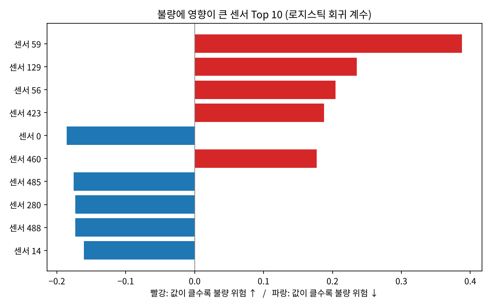

# SECOM 반도체 공정 불량 예측

반도체 공정 센서 데이터만으로 불량 제품을 미리 골라내는 프로젝트입니다.

## 한 줄 결과

> 생산품의 약 57%만 재검사해도 불량의 88%(17개 중 15개)를 잡는 **1차 재검사 필터**를 만들었습니다.

## 데이터

- 출처: [UCI SECOM Dataset](https://archive.ics.uci.edu/dataset/179/secom) (CC BY 4.0)
- 제품 1,567개, 센서 590개, 합격/불량 결과와 생산 시각 (2008-07-19 ~ 2008-10-17)
- 불량 104개 (6.6%) → 심한 불균형 데이터

`raw/` 폴더에 `secom.data`와 `secom_labels.data`를 넣고 실행하세요.

## 설계

| 항목 | 결정 | 이유 |
|---|---|---|
| 평가 지표 | 재현율, PR-AUC | 전부 "합격"이라 찍어도 정확도 93%가 나오므로 정확도는 의미 없음 |
| 데이터 분할 | 시간순 앞 80% 학습, 뒤 20% 시험 | 현장은 과거로 미래를 예측하므로 |
| 전처리 기준 | 학습 데이터만 보고 결정 | 시험 데이터를 미리 보면 성능이 부풀려짐 |

## 진행 과정

| 단계 | 파일 | 내용 | 결과 |
|---|---|---|---|
| 2 | `step2_check.py` | 데이터 확인 | 센서 116개는 값이 하나뿐, 28개는 빈 값 50% 초과 |
| 3 | `step3_baseline.py` | 로지스틱 회귀 | 재현율 0.24, PR-AUC 0.167 (무작위 0.054) |
| 4 | `step4_xgboost.py` | XGBoost | 재현율 0.06, PR-AUC 0.112 → **오히려 나빠짐** |
| 5 | `step5_threshold.py` | F2 점수로 기준선 조정 | 불량 17/17, 하지만 헛경보 65% |
| 6 | `step6_recall_target.py` | 목표 재현율로 기준선 조정 | 목표 90% → 불량 15/17, 헛경보 57% |
| 7 | `step7_top_sensors.py` | 영향 센서 분석 | 센서 59가 압도적 1위 |
| 8 | `step8_cost_threshold.py` | 비용 비율 C로 기준선 조정 | C ≤ 10 재검사 안 함, C = 20 → 36개 재검사(불량 6/17), C ≥ 30 → 248~286개 재검사(불량 17/17) |
| 9 | `step9_smote.py` | 불균형 처리 비교 (처리 없음, class_weight, SMOTE) | 목표 90% → 불량 14/17, 15/17, 16/17, 헛경보 58%, 57%, 63% → **차이 미미** |

### 목표 재현율별 결과 (시험 데이터)

| 목표 | 기준선 | 불량 잡음 | 헛경보 |
|---|---|---|---|
| 60% | 0.23 | 9/17 | 24% |
| 70% | 0.18 | 11/17 | 31% |
| 80% | 0.13 | 13/17 | 40% |
| **90%** | **0.07** | **15/17** | **57%** |

기준선은 모두 학습 데이터 안의 시간순 교차검증(TimeSeriesSplit)으로 골랐고, 시험 데이터는 마지막 평가에만 썼습니다.

### 불량에 영향이 큰 센서



계수는 상관관계일 뿐 원인은 아닙니다. 현장이라면 센서 59를 공정 엔지니어와 먼저 확인하겠습니다.

## 막혔던 문제와 해결

### 1. 센서 590개 중 116개는 쓸모가 없었다

모델을 돌리기 전에 데이터부터 봤다. 센서마다 값이 몇 종류인지 세어 보니 116개는 처음부터 끝까지 같은 값만 찍혀 있었다. 값이 안 변하면 불량과 합격을 가를 수 없으니 뺐고, 빈 값이 절반 넘는 센서 28개도 같이 뺐다. 남은 건 444개. 모델 한 번 안 돌리고 센서 4분의 1을 덜어낸 셈이다.

### 2. 시험 데이터는 마지막까지 보면 안 됐다

처음엔 전체 데이터로 빈 값을 채우고 센서를 고르려고 했는데, 그러면 시험 데이터 정보가 학습에 섞여 점수가 실제보다 좋게 나온다. 그래서 센서 선택, 빈 값 채우기, 단위 맞추기, 기준선 고르기까지 전부 학습 데이터 안에서만 했다. 데이터도 무작위로 섞지 않고 시간순으로 잘랐다. 현장에서는 지난달 데이터로 다음 달 제품을 판정하니까.

### 3. 복잡한 모델이 더 나빴다

XGBoost가 당연히 이길 줄 알았다. 결과는 재현율 0.24에서 0.06으로 떨어졌다. 학습용 불량이 87개뿐인데 센서는 444개라, 복잡한 모델이 학습 데이터를 외워버린 걸로 보인다. 시험 점수를 보면서 설정을 만지고 싶었지만 그건 시험지 보고 공부하는 거라 참았고, 최종 모델은 로지스틱 회귀로 정했다.

### 4. 불량을 다 잡았는데 쓸 수가 없었다

재현율 위주로 기준선을 고르니 불량 17개를 전부 잡았다. 문제는 합격품 65%에도 경보가 울렸다는 거다. 방법을 바꿔서 목표 재현율을 먼저 정하고, 그걸 채우는 기준선 중 헛경보가 제일 적은 걸 골랐다. 목표 90%에서 불량 15개를 잡았고 헛경보는 57%까지 내려왔다. 이 기준선을 어디에 둘지는 결국 불량 하나 놓치는 손해와 재검사 비용을 놓고 사람이 정할 문제였다. 그래서 그 비율(C)별로 기준선을 다시 골라 봤다. C가 10 이하면 재검사를 안 하는 게 제일 쌌고, 20이면 36개만 다시 봐서 불량 6개를 잡았고, 30 이상이면 248개 넘게 다시 봐서 불량을 전부 잡았다.

### 5. 모델에게 맡길 일을 다시 정했다

헛경보 57%로는 검사를 대신할 수 없다. 그래서 모델 역할을 "불량 판정"에서 "재검사할 제품 골라주기"로 바꿨다. 생산품의 절반 조금 넘게만 다시 보면 불량의 88%가 걸린다. 건설 공무 할 때도 자재를 전부 검수할 수는 없어서 위험한 것부터 골라 봤는데, 그때랑 같은 판단이었다.

### 6. SMOTE도 써 봤지만 차이가 없었다

불균형 처리라면 SMOTE도 써 봐야 공정한 비교라고 생각했다. 가짜 불량이 검증이나 시험 데이터에 섞이면 점수가 부풀려지니, 시간순 교차검증의 학습 구간 안에서만 만들었다. 결과는 SMOTE가 불량 16/17에 헛경보 63%, class_weight가 15/17에 57%였다. 불량 1개 차이로 거의 같았다. 아무 처리 안 한 모델도 14/17에 58%였다. 기준선을 검증으로 다시 정하면 불균형 처리 방법은 큰 차이를 못 만들었다. 그래서 가짜 데이터를 안 만드는 class_weight를 유지했다.

## 한계와 다음 단계

- 헛경보가 57%로 높아 단독 판정용으로는 부족합니다.
- 센서 이름이 가려져 있어 공정 지식을 반영하지 못했습니다.
- 다음: 정상 데이터만으로 학습하는 이상 탐지(Isolation Forest) 비교, 웨이퍼 이미지 데이터(WM-811K) 불량 패턴 분류

## 실행 방법

```bash
pip install -r requirements.txt
python step2_check.py
python step3_baseline.py
# ... step7까지 차례로
```
